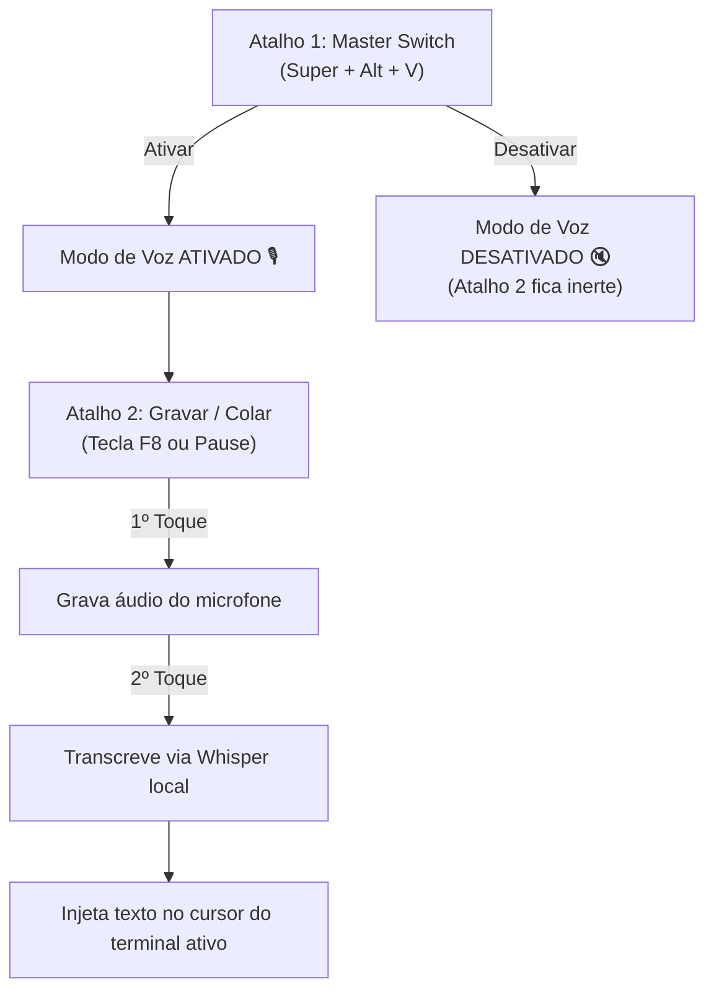

<p align="center">
  
</p>

<h1 align="center">TerminalVox 🎙️</h1>

<p align="center">
  <b>Instant, offline voice dictation for Linux terminals and AI coding agents.</b>
</p>

<p align="center">
  
  
  
  
</p>

---

**TerminalVox** is an ultra-fast, 100% offline speech-to-text bridge engineered for Linux developers interacting with **AI terminal agents** (such as Antigravity, Claude Code, Aider, Cursor CLI) and general shell environments.

Press a shortcut, speak your technical prompt or bash instruction, press again, and the transcribed text is automatically injected straight into your active terminal.

---

## ✨ Features

* 🔒 **100% Local & Private:** No external APIs, cloud dependencies, or data sent over the network.
* ⚡ **Sub-second Response:** Uses local CPU-optimized `whisper.cpp` (AVX2 + multithreading + greedy search).
* 🧠 **Developer & Git Context:** Tuned with technical vocabulary prompts (*branch, merge, commit, master, build, pull request, ESP32, Python, Linux, etc.*).
* ⌨️ **Automatic Terminal Injection:** Injects directly into the focused terminal prompt without overwriting your standard clipboard flow.
* 🛡️ **Master Switch:** Global enable/disable hotkey to ensure the microphone only listens when you explicitly want it to.
* 🐧 **Universal Linux Support:** Seamless on **Ubuntu, Debian, Fedora, Arch Linux, Pop!_OS, openSUSE**, running on either **Wayland** or **X11**.

---

## 🚀 Quick Start (Automated Install)

Clone the repository and run the universal installer:

```bash
git clone https://github.com/SEU_USUARIO/TerminalVox.git
cd TerminalVox
./install.sh
```

The script automatically:
1. Detects your distribution and installs required system dependencies (`apt`, `dnf`, `pacman`, or `zypper`).
2. Configures virtual keyboard permissions (`/dev/uinput`) if running Wayland.
3. Compiles `whisper.cpp` optimized for your CPU instruction set.
4. Downloads the multilingual Whisper model.

---

## 🎯 Usage (Dual Shortcut System)

TerminalVox is controlled via two keyboard shortcuts:



### 1. Master Switch (Ligar / Desligar Modo de Voz)
* **Command:** `~/TerminalVox/voice_master_switch.sh`
* **Suggested Hotkey:** `Super + Alt + V` or `F7`
* **Behavior:** Toggles the voice input state. When disabled, the recording hotkey is completely silent and does nothing.

### 2. Record & Paste (Gravar e Injetar)
* **Command:** `~/TerminalVox/voice_toggle.sh`
* **Suggested Hotkey:** `F8` or `Pause`
* **Behavior:** 
  * Tap once $\rightarrow$ Starts recording (notification: *🎙️ Gravando...*).
  * Speak your command.
  * Tap again $\rightarrow$ Transcribes locally and pastes the text directly into your terminal cursor.
  * Hit `Enter` to execute/send to your AI agent!

---

## 🖥️ Desktop Environment Setup

### GNOME (Ubuntu, Fedora, Pop!_OS)
1. Open **Settings** > **Keyboard** > **Keyboard Shortcuts** > **Custom Shortcuts** (`+`).
2. Add:
   * **Master Switch:** `bash -c "/path/to/TerminalVox/voice_master_switch.sh"`
   * **Voice Toggle:** `bash -c "/path/to/TerminalVox/voice_toggle.sh"`

### KDE Plasma
1. Open **System Settings** > **Shortcuts** > **Custom Shortcuts**.
2. Add **Global Shortcut** > **Command/URL** for both scripts.

### Tiling Window Managers (Hyprland, Sway, i3)
Add to your config (e.g., `hyprland.conf`):
```conf
bind = $mainMod ALT, V, exec, /path/to/TerminalVox/voice_master_switch.sh
bind = , F8, exec, /path/to/TerminalVox/voice_toggle.sh
```

---

## 📄 License

This project is licensed under the [MIT License](LICENSE).
